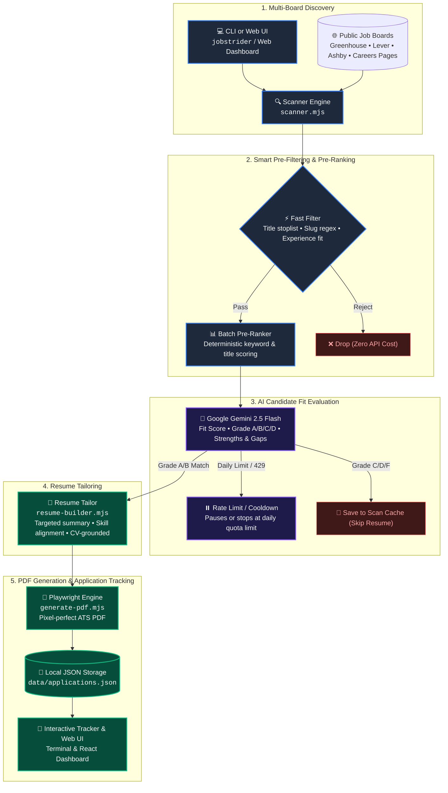

# JobStrider

> Autonomous, zero-operating-cost AI job pipeline and control room for scanning, evaluating, and tailoring applications for early-career software engineering roles.

[](https://github.com/anshuldeoli04/JobStrider/actions/workflows/ci.yml)
[](./LICENSE)
[](https://nodejs.org)
[](https://github.com/anshuldeoli04/JobStrider/releases)
[](https://anshuldeoli04.github.io/JobStrider/)

---

### 📥 One-Click Desktop App (Windows .exe)
> **Zero setup required.** For job seekers who want to run JobStrider immediately without terminal commands or Node.js:
> 
> 🔗 **[Download JobStrider v4.0.0 (.exe)](https://github.com/anshuldeoli04/JobStrider/releases/latest/download/JobStrider-4.0.0-x64.exe)** *(Windows 10/11 x64, 134 MB)*  
> 🌐 **Interactive Web Overview:** [https://anshuldeoli04.github.io/JobStrider/](https://anshuldeoli04.github.io/JobStrider/)

---

## ⚡ End-to-End Pipeline Workflow



---

## 📌 Full System Architecture & Design Principles

The complete architecture of JobStrider is structured into five isolated runtime zones, decoupling user interaction, high-throughput multi-source harvesting, pre-filtering security gates, BYOK LLM evaluation, and local-first persistence:

```mermaid
flowchart LR
    subgraph S1["🖥️ Client Presentation & CLI Cockpit"]
        USER["👤 Job Seeker / Dev"]
        COCKPIT["⚡ Web Cockpit<br/><code>frontend/src/App.jsx</code><br/>React + Vite SPA"]
        CLI["💻 AutoFlow CLI<br/><code>autoflow.mjs</code><br/>Interactive CLI Driver"]
    end

    subgraph S2["⚙️ Local Node.js Orchestrator & Harvester"]
        BRIDGE["🌉 Express Bridge<br/><code>frontend/server/zeroApi.js</code><br/>REST APIs & SSE Hub :3001"]
        RUNNER["⏱️ Process Runner<br/><code>process-runner.mjs</code><br/>Sanitized Subprocess Runner"]
        HEALTH["🩺 Source Health<br/><code>sourceVerifier.mjs</code><br/>Circuit Breaker State Machine"]
        ATS_SCAN["⚡ ATS API Scrapers<br/><code>src/scrapers/</code><br/>Greenhouse • Lever • Ashby • FreeHire"]
        STEALTH["🕵️ Stealth Scrapers<br/><code>browserLauncher.mjs</code><br/>Playwright Chromium + Stealth"]
        REACH["🌐 Deep Job Reader<br/><code>deepJobReader.mjs</code><br/>Agent Reach CLI Integration"]
    end

    subgraph EXT["🌐 External Platforms & APIs"]
        BOARDS[("🏛️ Public ATS Boards<br/>Greenhouse • Lever • Ashby")]
        PORTALS[("📑 Job Portals<br/>LinkedIn • Naukri • Internshala")]
        AI_CLOUD[("☁️ BYOK AI Cloud<br/>Google Gemini 2.5 • Groq Llama 3")]
    end

    subgraph S3["🛡️ Zero-Cost Security & Pre-Filter Sandbox"]
        GUARD["🛡️ Adversarial Posting Guard<br/><code>postingGuard.mjs</code><br/>Strips injections, HTML & homoglyphs"]
        FILTER["⚡ Pre-Rank & Filter<br/><code>jobFilterService.mjs</code><br/>Stoplist • Experience • Location Fit"]
        IDENT["🔑 Job Identity<br/><code>jobIdentity.mjs</code><br/>Canonical URL & Dedup Hash"]
    end

    subgraph S4["🤖 AI Fit Evaluation & ATS Compilation"]
        LLM["🧠 LLM Provider Router<br/><code>llmClient.mjs</code><br/>BYOK Key Manager & Breakers"]
        VALIDATOR["🔍 Fact Validator<br/><code>factValidator.mjs</code><br/>Strict Grounding against cv.md"]
        TAILOR["📝 Resume Tailor<br/><code>resume-builder.mjs</code><br/>Tailors summary, skills & projects"]
        PDF["📄 Playwright PDF<br/><code>generate-pdf.mjs</code><br/>Pixel-perfect ATS A4 printer"]
        VERIFIER["✅ Binary ATS Verifier<br/><code>atsVerifier.mjs</code><br/>0-100 ATS Score • Spill Audit"]
    end

    subgraph S5["💾 Local-First Storage & Artifact Repository"]
        SQLITE[("🗄️ SQLite Engine<br/><code>src/storage/db.mjs</code><br/>WAL Mode • Indexed Queries")]
        ATOMIC[("📁 Atomic JSON Store<br/><code>src/utils/fileLock.mjs</code><br/>applications.json • scan-cache.json")]
        REPOS[("📦 Output Artifacts<br/><code>output/resumes/</code><br/><code>reports/interview-prep/</code>")]
    end

    %% Client Layer Connections
    USER -->|"Browser UI"| COCKPIT
    USER -->|"Terminal Exec"| CLI
    COCKPIT -->|"REST & SSE"| BRIDGE
    CLI -->|"Exec Pipeline"| RUNNER
    BRIDGE -->|"Spawn Subproc"| RUNNER

    %% Harvester & External
    HEALTH -.->|"Circuit State"| ATS_SCAN
    ATS_SCAN <-->|"REST APIs"| BOARDS
    RUNNER --> ATS_SCAN
    RUNNER --> STEALTH
    RUNNER --> REACH
    REACH <-->|"Reach Scrape"| PORTALS
    STEALTH <-->|"Playwright Scrape"| PORTALS

    %% Ingestion to Security & Filter
    ATS_SCAN -->|"Discovered Jobs"| FILTER
    STEALTH -->|"Browser Jobs"| FILTER
    REACH -->|"Parsed Jobs"| FILTER
    FILTER -->|"Deduplicate"| IDENT
    FILTER -->|"Pass Filter"| GUARD

    %% AI Evaluation
    GUARD -->|"Sanitized JDs"| LLM
    LLM <-->|"BYOK Prompts"| AI_CLOUD
    LLM -->|"Fit Score & Gaps"| VALIDATOR

    %% Tailoring & ATS Compilation
    VALIDATOR -->|"Grade A/B Matches"| TAILOR
    TAILOR -->|"HTML Template"| PDF
    PDF -->|"Compiled PDF"| VERIFIER

    %% Persistence
    TAILOR -->|"Save Application"| SQLITE
    VERIFIER -->|"Sync JSON"| ATOMIC
    VERIFIER -->|"Write PDF & Dossier"| REPOS

    classDef client fill:#0f172a,stroke:#38bdf8,stroke-width:1.5px,color:#f8fafc;
    classDef runtime fill:#1e293b,stroke:#818cf8,stroke-width:1.5px,color:#f8fafc;
    classDef security fill:#2e1065,stroke:#c084fc,stroke-width:1.5px,color:#f8fafc;
    classDef ai fill:#052e16,stroke:#34d399,stroke-width:1.5px,color:#f8fafc;
    classDef storage fill:#1c1917,stroke:#fb923c,stroke-width:1.5px,color:#f8fafc;
    classDef external fill:#18181b,stroke:#a1a1aa,stroke-dasharray:3 3,color:#e4e4e7;

    class USER,COCKPIT,CLI client;
    class BRIDGE,RUNNER,HEALTH,ATS_SCAN,STEALTH,REACH runtime;
    class GUARD,FILTER,IDENT security;
    class LLM,VALIDATOR,TAILOR,PDF,VERIFIER ai;
    class SQLITE,ATOMIC,REPOS storage;
    class BOARDS,PORTALS,AI_CLOUD external;
```



> [!TIP]
> **Interactive Archify Diagram**: An explorable, vector-accurate standalone HTML architecture visualization with dark/light mode and component source tracing is available at [`.archify/architecture-full-system-20261117-134500/full-system.html`](.archify/architecture-full-system-20261117-134500/full-system.html).

### Architectural Invariants & Subsystem Design

1. **Dual Cockpit Interface (Presentation)**:
   - **Vite + React Dashboard (`frontend/`)**: Real-time control room consuming REST endpoints and Server-Sent Events (SSE) for live runner log streaming.
   - **Autonomous AutoFlow CLI (`autoflow.mjs`)**: Headless or interactive terminal runner with two-stage human-in-the-loop checkpoints before LLM evaluation and resume generation.

2. **Orchestrator & Ingestion Engine (Harvester)**:
   - **Express Bridge (`frontend/server/zeroApi.js`)**: Isolated backend server on port 3001 with rate limiting and strict CORS handling.
   - **Subprocess Isolation (`process-runner.mjs`)**: Spawns isolated worker processes with sanitized environments (`sanitizeChildEnv`), systematically scrubbing sensitive credentials and database master keys.
   - **Multi-Channel Harvesters (`src/scrapers/`)**: Fetches jobs via official REST endpoints (Greenhouse, Lever, Ashby, FreeHire), Playwright Chromium with stealth plugins for complex portals, and the Agent Reach CLI for credential-free LinkedIn deep-scraping.
   - **Fetch Health State Machine (`sourceVerifier.mjs`)**: Continuous health classification across 7 states (`HEALTHY`, `DEGRADED`, `EMPTY`, `SELECTOR_BROKEN`, `BLOCKED`, `THROTTLED_TIMEOUT`, `ERROR`) logged to `data/health-log.jsonl`.

3. **Zero-Cost Security & Pre-Filter Sandbox**:
   - **Adversarial Posting Guard (`postingGuard.mjs`)**: Strips invisible zero-width Unicode characters (`\u200B-\u200D`, `\uFEFF`), script tags, HTML comments, and heuristic prompt-injection triggers before sending text to AI models.
   - **Deterministic Pre-Filters (`jobFilterService.mjs`, `experienceService.mjs`)**: Filters titles against stoplists, enforces experience fit criteria, and filters locations at zero API token cost.
   - **Job Identity & Deduplication (`jobIdentity.mjs`)**: Canonicalizes URLs, scrubs tracking parameters, and computes deterministic content hashes to eliminate duplicate postings across runs.

4. **AI Fit Evaluation & ATS Compilation Engine**:
   - **Multi-Provider LLM Router (`llm/llmClient.mjs`)**: Direct Bring-Your-Own-Key (BYOK) client managing Google Gemini 2.5 Flash and Groq Llama 3 with quota trackers and circuit breakers.
   - **Strict Grounding Fact Validator (`llm/factValidator.mjs`)**: Deterministic verification preventing AI hallucinations; enforces that all tailored skills, employers, and degrees originate strictly from the candidate's master [`cv.md`](./cv.md).
   - **Pixel-Perfect Resume Tailoring (`resume-builder.mjs`, `generate-pdf.mjs`)**: Generates targeted HTML templates and renders them to print-ready A4 PDFs using headless Playwright.
   - **Binary ATS Verifier (`atsVerifier.mjs`)**: Audits compiled PDF binary streams using `pdf-parse`, scoring text layer readability (0-100 pts), validating contact integrity, and preventing multi-page overflow spills.

5. **Local-First Storage & Data Sovereignty**:
   - **Embedded SQLite Engine (`src/storage/db.mjs`)**: `better-sqlite3` database (`data/job-ops.db`) operating in WAL mode with indexes across companies, grades, and statuses.
   - **Atomic JSON Synchronization (`src/utils/fileLock.mjs`)**: Disk storage backed by transactional file locking (`applications.json`, `scan-cache.json`) for zero-database deployment flexibility.
   - **Immutable File Artifacts**: Rendered resumes and interview preparation dossiers reside strictly in local directories (`output/resumes/` and `reports/`).

---

## 🔍 Supported Sources & Health Monitoring

The scanner queries 7 distinct channels, each classified using a dedicated fetch-health state machine (`HEALTHY`, `DEGRADED`, `EMPTY`, `SELECTOR_BROKEN`, `BLOCKED`, `THROTTLED_TIMEOUT`, `ERROR`):

| Source | Method | Authentication | Default State |
|---|---|---|---|
| **Greenhouse** | Public Boards API (`/v1/boards/<slug>/jobs`) | None | Active (Default) |
| **Lever** | Public Postings API (`/v0/postings/<slug>`) | None | Active (Default) |
| **Ashby** | Public Posting API (`/posting-api/job-board/<slug>`) | None | Active (Default) |
| **Careers Pages** | Headless Playwright + JSON-LD Extraction | None | Active (Default) |
| **Internshala** | Stealth Browser (India freshers/interns) | None | Opt-in (`disabled_sources`) |
| **Naukri** | Stealth Browser + Next.js hydration wait | None | Opt-in (`disabled_sources`) |
| **Wellfound** | Stealth Browser (AngelList startups) | None | Opt-in (`disabled_sources`) |

> [!NOTE]
> Fast API sources run by default without browser overhead. To enable browser sources, see [Enabling Browser Sources](#enabling-browser-sources). All health states are recorded in `data/health-log.jsonl`.

---

## 🚀 Quick Start (CLI Mode - 5 Minutes)

### 1. Installation & Guided Setup

**Recommended: Interactive Onboarding Wizard**
```bash
npm install
npm run setup
node setup-check.mjs
```

Or configure manually:
```bash
npm install
npx playwright install chromium
cp config.example.json config.local.json
cp env.example .env
cp cv.example.md cv.md
node setup-check.mjs
```

### 2. Configure Your API Key
1. Get a free Gemini key from [Google AI Studio](https://aistudio.google.com/apikey).
2. Open `.env` and set:
   ```env
   GEMINI_API_KEY=your_actual_key_here
   ```
3. Update [`cv.md`](./cv.md) with your real technical background, skills, and projects.

### 3. Launch & Run

#### Option A: One-Click Web Cockpit (Recommended for All Users)
```bash
npm run ui
```
Opens the interactive **JobStrider Dashboard** (`http://localhost:3000`) with zero database installation required (embedded SQLite + JSON synchronization).

#### Option B: Terminal CLI Mode
```bash
# Full automated pipeline (Scan -> Calibrate -> Tailor)
node autoflow.mjs

# Or individual pipeline stages:
node scanner.mjs                  # Scan enabled sources
node scan-evaluate.mjs --mode=auto # Evaluate discovered jobs
node tracker.mjs                  # Terminal application tracker
```

---

## 🛠️ Core CLI Workflows

### 1. End-to-End Pipeline (`autoflow.mjs`)
The primary driver for hands-free or interactive job hunting:
```bash
node autoflow.mjs
```
- **Step 1**: Discovers new jobs across enabled sources (Greenhouse, Lever, Ashby, and verified career pages by default; Internshala and Naukri are opt-in).
- **Step 2**: Prompts for confirmation and batch-evaluates matching candidates using Gemini 2.5 Flash.
- **Step 3**: Renders a ranked candidate matrix and generates tailored resumes for selected matches (or automatically via `--auto-tailor` / `--yes`, bounded by `--tailor-top=N`).

#### Autoflow Exit Codes
- `0`: Pipeline completed successfully.
- `1`: Execution error encountered.
- `2`: Daily quota limit reached or user aborted.

### 2. Live Job Scanner (`scanner.mjs`)
Scans all enabled sources without modifying existing application records:
```bash
# Scan all enabled channels
node scanner.mjs

# Scan specific sources with keyword overrides
node scanner.mjs --sources=ashby,greenhouse,reach_linkedin,freehire --keywords="software engineer"
```

#### Multi-Platform Discovery (Agent Reach & FreeHire)
JobStrider supports multi-platform retrieval:
- **FreeHire Remote**: Fast REST scraper for global remote software engineering roles (`--sources=freehire`).
- **Agent Reach (LinkedIn)**: Headless-free, credential-free LinkedIn job discovery via the Agent Reach CLI (`--sources=reach_linkedin`).

#### Enabling Browser Sources (Naukri, Internshala, Wellfound)
Official public APIs (Greenhouse, Lever, Ashby, FreeHire) and Agent Reach are fast and lightweight. Stealth browser-based sources require Playwright Chromium and are opt-in.
To enable browser sources:
1. Ensure Playwright Chromium is installed: `npx playwright install chromium`
2. In `config.local.json` (or `config.json`), remove them from `disabled_sources`:
   ```json
   {
     "disabled_sources": []
   }
   ```
3. Or invoke a targeted run directly via `--sources`:
   ```bash
   node scanner.mjs --sources=naukri,internshala
   ```

### 3. Deep Fit Evaluator (`evaluate.mjs`)
Paste any job description from LinkedIn, Indeed, or company websites to get an instant candidate fit assessment:
```bash
node evaluate.mjs

# Or evaluate directly from a URL via Agent Reach deep reader:
node evaluate.mjs --url=https://www.linkedin.com/jobs/view/123456789/
```
Generates fit score (1-10), calibrated letter grade (A+ through F), key strengths, honest skill gaps, and custom interview prep questions.

### 4. Intelligent Resume Tailoring & ATS Verifier (`resume-builder.mjs`)
Generates tailored, high-ATS-yield PDF and HTML resumes aligned directly with target job requirements:
```bash
# Interactive selection from evaluated jobs
node resume-builder.mjs

# Directly target a specific tracked application
node resume-builder.mjs --job-id=<application_id>
```
Post-rendering, the built-in **ATS Verifier** (`atsVerifier.mjs`) parses the binary PDF stream, computes an ATS readability score (0-100 pts), validates contact details, verifies section headings, and flags orphan lines spilling onto page 2.

### 5. Interview Preparation Copilot (`interview-prep.mjs`)
Generates role-specific interview preparation dossiers grounded in your actual CV experience:
```bash
node interview-prep.mjs
```
Produces structured STAR behavioral stories, technical Q&A topics, honest skill gap bridges, and strategic questions for the interviewer, saving reports to `reports/interview-prep/`.

### 6. Application Tracker & Outreach Copilot (`tracker.mjs`)
An interactive terminal dashboard for reviewing evaluated jobs, generating follow-up outreach drafts for stale applications (pending >= 10 days), and tracking your application lifecycle:
```bash
node tracker.mjs
```

---

## 🛡️ Security & Privacy Architecture

- **Adversarial Posting Guard**: All incoming job descriptions and scraped postings are sanitized through `postingGuard.mjs` before being passed to LLM prompts, stripping invisible zero-width Unicode characters, hidden HTML comments, script tags, prompt-injection patterns, and cross-script homoglyphs.
- **Subprocess Environment Sanitization**: Subprocesses launched by the CLI runner inherit a strictly allow-listed environment (`sanitizeChildEnv`). System secrets, database passwords, and master keys are systematically scrubbed before executing child scripts.
- **Zero Cloud Storage / 100% Local**: All scan results, application histories, tailored resumes, and evaluation reports are stored locally on your machine in atomic JSON and Markdown files under `data/`, `output/`, and `reports/`.
- **Bring Your Own Key (BYOK)**: All LLM evaluations and resume tailoring run directly against your personal Gemini or Groq API keys with zero telemetry or middleman servers.

---

## ⚖️ Disclaimers & Legal Notice

- **Third-Party Platform Terms**: Users are solely responsible for complying with each job platform's terms of service, robots.txt directives, and applicable local laws. The maintainers do not endorse or encourage circumventing technical access controls or terms of service. This software is provided strictly for personal, non-commercial developer job-seeking automation.
- **LLM Data Privacy**: Candidate resumes and job descriptions are sent to Google Gemini and Groq APIs for scoring and text tailoring. Please review [Google AI Studio Terms of Service](https://ai.google.dev/terms) and [Groq Terms](https://groq.com) regarding data logging on free-tier plans.
- **Single Key BYOK & Free-Tier Quotas**: The system uses a Bring-Your-Own-Key model. Pacing and circuit breakers prevent API hammering, but daily free-tier quotas are governed strictly by the upstream providers.

---

## 📄 License & Community

- **License**: [MIT](./LICENSE)
- **Security Policy**: [SECURITY.md](./SECURITY.md)
- **Contributing Guidelines**: [CONTRIBUTING.md](./CONTRIBUTING.md)
- **Code of Conduct**: [CODE_OF_CONDUCT.md](./CODE_OF_CONDUCT.md)
